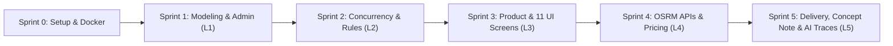

# 🚀 Roadmap & Sprints — Regional Carpooling Platform (Subject 3)
**Project:** PFE Challenge EMC — Technopark Souss Massa  
**Candidate:** Moaad Daoudi (State Digital Transformation | Artificial Intelligence Engineer)  
**Required Stack:** Symfony 7.4 (PHP 8.3), MySQL 8.0, Docker, Doctrine ORM, Twig / Tailwind / Stimulus  
**Timeline:** 7 Days (5 Sprints mapped to the 5 Challenge Levels)

---

## 📊 Project Alignment Matrix



---

## 🏗️ Role & Security Architecture (Senior Pattern)

* **2 Technical Security Roles (`security.yaml`):**
  * `ROLE_USER`: Single unified member account capable of acting as both Passenger and Driver.
  * `ROLE_ADMIN`: Exclusive access to the Back-Office (`/admin` via EasyAdmin).
* **2 Contextual Domain Roles (Enforced via Symfony Voters):**
  * `TripVoter` (`TRIP_BOOK`, `TRIP_MANAGE`, `TRIP_CANCEL`): Prevents drivers from booking their own trips and restricts trip management to the trip owner.
  * `BookingVoter` (`BOOKING_CANCEL_PASSENGER`): Validates passenger cancellation policies.
  * `ReviewVoter` (`REVIEW_CREATE`): Only permits reviews if the trip is `COMPLETED`, the user was a confirmed participant, and has not already reviewed that person for that trip.
* **4 Pre-configured Demo Accounts in DataFixtures:**
  1. `admin@covoit.ma`: System Administrator (`ROLE_ADMIN`).
  2. `amina@covoit.ma`: Dual Persona (`ROLE_USER`, owns a verified vehicle, has published trips AND has passenger bookings).
  3. `karim@covoit.ma`: Driver with past completed trips (allows immediate testing of post-trip reviews and ratings).
  4. `youssef@covoit.ma`: Passenger without a car (tests partial segment bookings, cancellation policies, and vehicle prompts).

---

## 🗺️ Screen Blueprint: 11 UI Views + 1 Unified Back-Office

| ID | Route | Screen / Component | Core Purpose & Features |
|:---|:---|:---|:---|
| **S01** | `/` | Home & Unified Trip Search | Search bar (Origin, Destination, Date, Seats) + Matching trip cards displaying exact sub-segment match, remaining seats, and segment price. |
| **S02** | `/trips/{id}` | Trip Details & Segment Booking *(Hero Screen #1)* | Interactive Leaflet/OSRM route map, stop timeline, dynamic sub-segment selector, live availability/pricing, and booking CTA. |
| **S03** | `/bookings/{id}/checkout` | Simulated Payment & Confirmation | Segment recap, cancellation policy reminder, transactional lock trigger, and seat deduction. |
| **S04** | `/my/bookings` | Passenger Dashboard | Two tabs (*Upcoming* | *Past & Cancelled*), cancellation modal, and "Leave a review" button (active if trip is `COMPLETED`). |
| **S05** | `/driver/trips/new` | Publish a Trip *(Hero Screen #2)* | Dynamic intermediate stop fields (Stimulus), Leaflet route preview, OSRM real road distance calculation, and suggested price auto-fill. |
| **S06** | `/driver/trips` | Driver Dashboard | Two tabs (*Published / Upcoming* | *History*), occupancy gauge, and a "Mark as Completed" action button for easy evaluator review testing. |
| **S07** | `/driver/trips/{id}` | Passenger Manifest & Trip Management | Detailed boarding/exiting manifest per stop, confirmed passenger contact info, and driver cancellation trigger. |
| **S08** | `/users/{id}` | Public Profile & Reviews | Bio, registered vehicles, badges, aggregate star rating, and verified review feed. |
| **S09** | `/trips/{id}/review` | Submit Review | Star rating (1 to 5) + comment form, strictly protected by `ReviewVoter`. |
| **S10** | `/account` | My Account & Vehicles | Profile management + "My Vehicles" tab (enables any `ROLE_USER` to seamlessly act as a driver). |
| **S11** | `/login` & `/register` | Authentication | Standard login form + "1-Click Demo Login" box with 4 prefilled buttons for instant jury testing. |
| **S12** | `/admin` | EasyAdmin 4 Back-Office | Full CRUD administration: Cities, Users, Vehicles, Trips, Bookings, and Review moderation. |

---

## 📅 Detailed Sprints & Actionable Tickets

### 🔹 Sprint 0: Initialization, Docker Environment & Git Baseline (Day 1 - Morning)
> **Goal:** Build the complete multi-container Docker foundation and establish the initial public GitHub repository commit.

- [ ] **T-001: Multi-Container Docker Configuration**
  - `php` container: PHP 8.3 FPM, Composer, extensions (`pdo_mysql`, `intl`, `opcache`, `zip`).
  - `web` container: Nginx with optimized Symfony vhost pointing to `public/index.php`.
  - `database` container: MySQL 8.0 with persistent storage volume and healthcheck.
- [ ] **T-002: Symfony 7.4 Skeleton Setup**
  - Install via Composer: `symfony/webapp-pack`, `symfony/orm-pack`.
  - Configure `.env.example` and test database environments.
- [ ] **T-003: Public Git Repository Setup**
  - Create the public repository: `emc-pfe-covoiturage`.
  - Push the baseline commit: `chore(init): initial symfony 7.4 skeleton with docker environment`.
  - Set up `docs/` folder and `README.md` structure.

---

### 🔹 Sprint 1: Level 1 — Domain Modeling, Fixtures & Back-Office (Day 1 Afternoon - Day 2)
> **Goal:** Design the relational domain model, generate realistic Moroccan seed data, and deliver the EasyAdmin back-office.

- [x] **T-101: Domain Entity Modeling**
  - `User`: Implements `UserInterface`, profile info, avatar, phone.
  - `Vehicle`: License plate, make, model, color, total seats.
  - `City`: Name (Agadir, Marrakech, Essaouira, Casablanca...), latitude, longitude.
  - `Trip`: Driver, vehicle, departure city, arrival city, departure datetime, status (`SCHEDULED`, `COMPLETED`, `CANCELLED`).
  - `TripStop`: Ordered intermediate stops (`stopOrder`), estimated arrival time.
  - `TripSegment`: Atomic segment connecting 2 consecutive stops, available seats, calculated price.
  - `Booking`: Passenger, trip, boarding stop, drop-off stop, seat count, status (`CONFIRMED`, `CANCELLED_PASSENGER`, `CANCELLED_DRIVER`), total price.
  - `BookingSegment`: Junction entity mapping reserved seats across each atomic segment.
  - `Review`: Author, recipient, trip, rating (1-5), comment, creation timestamp.
- [x] **T-102: Doctrine Migrations**
  - Generate and run the initial migration with foreign key constraints and query indexes.
- [x] **T-103: Realistic Moroccan Fixtures (`AppFixtures`)**
  - Integrate `FakerPHP`.
  - Seed 15 Moroccan cities with accurate geographic coordinates.
  - Seed the **4 mandatory demo accounts**.
  - Generate 20 realistic trips (future trips, fully booked trips, and completed trips with reviews).
- [x] **T-104: EasyAdmin 4 Setup (Screen S12)**
  - Install `easycorp/easyadmin-bundle`.
  - Centralized `/admin` dashboard protected by `ROLE_ADMIN`.
  - CRUD Controllers: `CityCrudController`, `UserCrudController`, `VehicleCrudController`, `TripCrudController`, `BookingCrudController`, `ReviewCrudController`.
- [x] **T-105: Domain Documentation (`docs/MODELE.md`)**
  - Comprehensive Mermaid ER diagram.
  - Architectural justification for the atomic `TripSegment` model solving the sub-segment booking challenge.

---

### 🔹 Sprint 2: Level 2 — Business Rules, Concurrency & Automated Tests (Day 3)
> **Goal:** Enforce data integrity, eliminate race conditions via database locks, and achieve full PHPUnit test coverage.

- [x] **T-201: Segment Inventory & Booking Engine**
  - Create the `BookingService` domain service.
  - Segment overlap check: Booking from stop $i$ to stop $j$ validates that all atomic segments $[i, i+1], ..., [j-1, j]$ satisfy `availableSeats >= requestedSeats`.
- [x] **T-202: Concurrency Control & Pessimistic Locking**
  - Wrap the booking logic inside `$entityManager->wrapInTransaction()`.
  - Execute pessimistic write locks (`LockMode::PESSIMISTIC_WRITE` / `SELECT ... FOR UPDATE`) on target `TripSegment` entities.
  - Decrement seats atomically; trigger automatic transaction rollback if capacity is exceeded.
- [x] **T-203: Distinct Cancellation Policies**
  - **Passenger Cancellation**: Immediate seat release across booked segments, update status to `CANCELLED_PASSENGER`. Implement threshold rules (>24h: 100% refund, <24h: 50%).
  - **Driver Cancellation**: Cascading cancellation of all related passenger bookings with status `CANCELLED_DRIVER` and notifications.
- [x] **T-204: Review Eligibility Guardrails**
  - Enforce prerequisite conditions: Trip must be `COMPLETED`, booking must be `CONFIRMED`, and limit to 1 review per participant per trip.
- [x] **T-205: Automated Test Suite with PHPUnit (`tests/`)**
  - `SegmentOverlapTest`: Unit test validating available seat calculations across multi-leg journeys.
  - `BookingConcurrencyTest`: Integration test simulating concurrent requests competing for the last available seat.
  - `CancellationRulesTest`: Unit tests for passenger vs driver cancellation policies.
  - `ReviewEligibilityTest`: Security test validating review restrictions on upcoming or cancelled trips.

---

### 🔹 Sprint 3: Level 3 — Product Experience & 11 UI Screens (Day 4 - Day 5)
> **Goal:** Build an intuitive, responsive user experience (Tailwind + Stimulus, prototyped via Stitch AI) covering all passenger and driver flows.

- [x] **T-301: Base Layout & Design System (`templates/base.html.twig`)**
  - Modern Plus Jakarta Sans typography, customized Tailwind palette matching Stitch AI (`brand` emerald `#0d9488` and `forest` dark green `#06231e`).
  - Sticky responsive navbar with dual-role navigation, user status indicator, and mobile sheet.
  - Moroccan CNDP footer with compliance badges, payment guarantees, and quick links.
  - Business flash message alert banners (success, warnings, transactional errors).
- [x] **T-302: Screen S01 — Home & Search Experience (`/`)**
  - Hero section with deep forest green gradient, verified badge, and floating search bar with interactive swap button `⇄`.
  - Trust & Quality Metrics Bar: 15 000+ rides, 4.9/5 rating, 100% CNI/Permis verified, 0 DH hidden fees.
  - Two-column search results: filter sidebar (time slots, price range slider, AC/luggage/female-driver toggles) + trip cards with detailed timelines, urgency badges ("Dernière place disponible !"), driver badges, vehicle specs, and "Garantie Prix Équitable".
  - "Pourquoi choisir SafarCar ?" value-proposition cards and "Ce que disent nos voyageurs" community testimonial section matching the Stitch AI prototype.
- [x] **T-303: Screen S02 — Trip Details & Segment Booking (`/trips/{id}`)**
  - Trip header banner with emerald glow, LIGNE EXPRESS badge, CO₂ footprint reduction (-68%), and instantaneous booking guarantee.
  - Interactive Leaflet.js map with numbered markers for each city stop and road polyline.
  - Step-by-step segment timeline with stop badges, meeting addresses, and dynamic urgency badges ("1 seule place restante").
  - Driver profile card with photo initials, "SUPER CONDUCTEUR" badge, rating stars, verification pills (CNI, Permis >5 ans, Assurance), and 5-card comfort grid (AC, luggage, 2 back, non-smoker).
  - Sticky interactive booking configuration module with client-side reactive sub-trip matrix: changing origin and destination dynamically recalculates price, bottleneck capacity, distance, and warning alerts without page reload.
- [x] **T-304: Screen S03 — Simulated Checkout (`/trips/{id}/checkout`)**
  - 3-step progress bar (Sélection trajet, Coordonnées, Paiement & Confirmation).
  - Verified passenger identity card with WhatsApp notification notice.
  - Payment options selection (SafarCar Express simulé, Carte CMI / Visa / Mastercard 3D-Secure, Espèces au conducteur).
  - Complete T-203 flexible cancellation policy recap (>24h: 100%, <24h: 50% refund).
  - Sticky route summary card with driver badge, vehicle info, exact timeline, and transparent price breakdown (0 DH hidden fees).
- [x] **T-305: Screen S04 — Passenger Dashboard (`/my/bookings`)**
  - "Espace Passager Privilège" with 3 top KPI metric cards (Trajets à venir, Économies réalisées, CO₂ évité).
  - Dual tabs (Trajets à venir & Historique des voyages passés).
  - Real-time booking card with remaining countdown, boarding/drop-off points, direct driver call & WhatsApp CTAs.
  - Interactive actions: digital boarding pass, itinerary link, and atomic cancellation modal with automatic refund calculation.
  - Completed trip review trigger button and AXA insurance guarantee banner.
- [x] **T-306: Screen S05 — Publish a Trip (`/driver/trips/new`)**
  - High-end certified driver banner matching Stitch S05 with Level 3 verification card (CNI & Permis validés, 4.96 ★).
  - Multi-stop itinerary configuration with dynamic intermediate stops (`⊕ Ajouter une escale`, `✕ Retirer`).
  - Moroccan license plate styled vehicle selector (`26842 | أ | 33`, `71984 | ب | 26`).
  - Algorithm-compliant price distribution adhering to ADM barème with dynamic per-segment recalculation.
  - Sticky right column with OSRM optimal route schema, live earnings calculation (`seats * price`), 24h payout guarantee, and direct publication CTA.
  - Transactional persistence of `Trip`, ordered `TripStop`s, and consecutive atomic `TripSegment`s.
- [x] **T-307: Screens S06 & S07 — Driver Space & Manifest (`/driver/trips`, `/driver/trips/{id}`)**
  - S06: "Espace Conducteur Privilège" matching Stitch prototype with 4 KPI cards (Planification, Revenus du mois, Ponctualité & Avis, Remplissage moyen).
  - 3 dynamic tabs: *Trajets publiés (actifs)*, *Historique & Archivés*, and *Mes véhicules homologués*.
  - Multi-segment trip card with detailed breakdown, segment pricing, passenger avatar stack, and live occupancy gauge.
  - Interactive "Marquer comme terminé" action enabling immediate review eligibility for evaluators.
  - Driver cancellation action with 100% passenger refund cascade via `CancellationService`.
  - S07: Official passenger manifest with stop-by-stop passenger check-in and printable boarding sheet.
- [x] **T-308: Screens S08 & S09 — Public Profiles & Review System (`/users/{id}`, `/trips/{id}/review`)**
  - S08: Public profile matching Stitch AI prototype (`stitch_s08_user_profile.png`) with calculated average ratings breakdown (5.0 conduite, 5.0 communication, 4.9 propreté, 4.8 ambiance), verified driver badges (CNI CNDP, Permis B, Assurance AXA), registered vehicles list, and chronological passenger review cards.
  - S09: 5-star rating form matching Stitch AI prototype (`stitch_s09_trip_review.png`) with positive highlight pills, structured criteria evaluation, dynamic comment counter, and business validation via `ReviewManager`.
- [x] **T-309: Screen S10 — Account & Vehicle Management (`/account`)**
  - Profile settings and vehicle management matching Stitch AI prototype (`stitch_s10_account_settings.png`): personal details form, Moroccan license plate styled vehicle cards with comfort options, dynamic vehicle addition modal/card, and CNDP regulatory compliance banner.
- [x] **T-310: Screen S11 — Authentication & 1-Click Demo Login (`/login`)**
  - High-end authentication interface matching Stitch AI prototype (`stitch_s11_login_demo.png`): credentials form, "Se souvenir de moi", and 4 interactive 1-click evaluation buttons (`Amina · Dual`, `Karim · Conducteur`, `Youssef · Passager`, `Admin · Back-office`) pre-filling credentials for instant jury evaluation.
  - Standard Symfony login form.
  - **Jury Quick-Test Box**: 4 buttons that prefill credentials for `Admin`, `Amina (Dual)`, `Karim (Driver)`, and `Youssef (Passenger)`.

---

### 🔹 Sprint 4: Level 4 — External APIs (Nominatim + OSRM) & Dynamic Pricing (Day 6)
> **Goal:** Power the platform with OpenStreetMap geocoding, real OSRM road routing, and automated suggested pricing.

- [ ] **T-401: Nominatim Geocoding Service (`NominatimService`)**
  - Symfony HttpClient integration querying Nominatim API.
  - Filesystem/Redis caching layer for coordinates to strictly respect OSM usage policies.
- [ ] **T-402: OSRM Routing Service (`OsrmService`)**
  - Call OSRM API (`/route/v1/driving/`) with stop sequences.
  - Retrieve accurate road distance in kilometers, estimated duration, and GeoJSON polyline.
  - Resilient fallback handling in case of network timeouts.
- [ ] **T-403: Suggested Pricing Calculator (`PricingService`)**
  - Transparent pricing formula: $Price = BaseCost + (Distance_{km} \times Rate_{km}) \times DegressiveFactor$.
  - Automated breakdown of suggested pricing across all intermediate legs.
- [ ] **T-404: Front-End Interactive Map Integration (Leaflet.js)**
  - Stimulus controller rendering the map on trip publish (S05) and trip details (S02).
  - Draw the real OSRM route geometry and place custom markers for all stops.

---

### 🔹 Sprint 5: Level 5, Deliverables & AI Traces Bonus (+15 pts) (Day 7)
> **Goal:** Finalize the turnkey Docker deployment, compile documentation, write the 1-page concept note, and package AI traces.

- [ ] **T-501: Automated Turnkey Docker Deployment (Level 5)**
  - Automated container startup running migrations and fixtures in a single command:
    ```bash
    docker compose up -d
    ```
  - Verify complete fresh installation on a clean machine.
- [ ] **T-502: Step-by-Step Installation Guide (`INSTALL.md`)**
  - Clear prerequisites (Docker & Docker Compose).
  - Exact startup commands.
  - Table of demo accounts and passwords.
  - Automated test execution commands.
- [ ] **T-503: Architectural Decision Records (`docs/DECISIONS.md`)**
  - Document clear answers to the challenge's "Questions to Decide".
  - Architectural justification: *2 Security Roles + Contextual Voters*.
  - Concurrency design rationale: *Pessimistic Locking vs Optimistic Locking*.
- [ ] **T-504: 1-Page Conceptual Note PDF (`note_conceptuelle.pdf`)**
  - Executive 6-section summary: Subject choice, requirement decomposition, architectural decisions, execution order, AI steering methodology, and +1 week roadmap.
  - Clean 1-page PDF export.
- [ ] **T-505: AI Traces Archive (`traces-ia.zip`) & `LISEZMOI.md` (+15 pts Bonus)**
  - Export AI Studio chats (Gemini Hydrogen) and Antigravity logs.
  - Complete `LISEZMOI.md` documenting tools used, archive contents, and **3 key learnings** (time saved, AI hallucinations/errors, and engineering corrections applied).
  - Sanitize and remove all personal tokens, passwords, and API keys.
- [ ] **T-506: Final Git Repository Review & Submission Preparation**
  - Verify clean, linear commit history on `main` branch (no squashing or forced rebase).
  - Tag release `v1.0.0`.
  - Draft formal submission email to `pfe@educationmedia.ma`.

---

## 📈 Weekly Sprint Tracking Dashboard

| Day | Primary Sprint | Key Deliverable | Status |
|:---|:---|:---|:---:|
| **Day 1** | Sprint 0 & 1 | Operational Docker + Symfony 7.4 Skeleton + Domain Entities | ⏳ In Progress |
| **Day 2** | Sprint 1 | Moroccan Seed Data + Functional EasyAdmin Back-Office | ⏳ Pending |
| **Day 3** | Sprint 2 | `PESSIMISTIC_WRITE` Concurrency + Passing PHPUnit Tests | ⏳ Pending |
| **Day 4** | Sprint 3 | Passenger Flow (Search, Details, Checkout, Bookings) | ⏳ Pending |
| **Day 5** | Sprint 3 | Driver Flow + Public Profiles + Verified Reviews | ⏳ Pending |
| **Day 6** | Sprint 4 | OSRM & Nominatim Integration + Leaflet Route Map | ⏳ Pending |
| **Day 7** | Sprint 5 | `INSTALL.md`, 1-Page PDF Note, AI Traces & Final Submission | ⏳ Pending |
