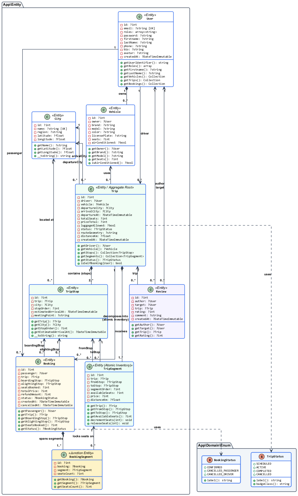
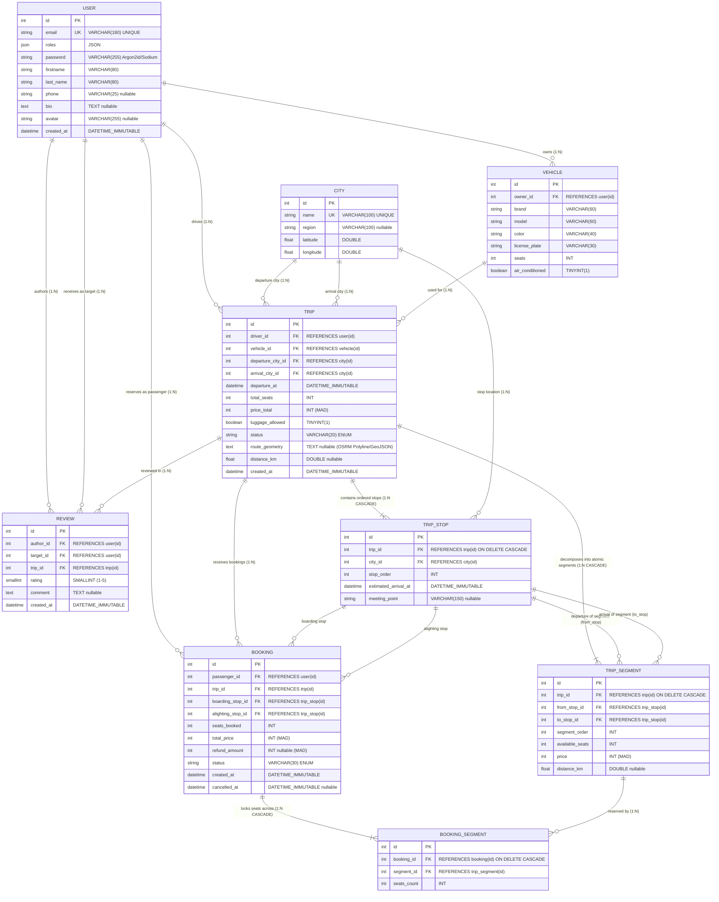
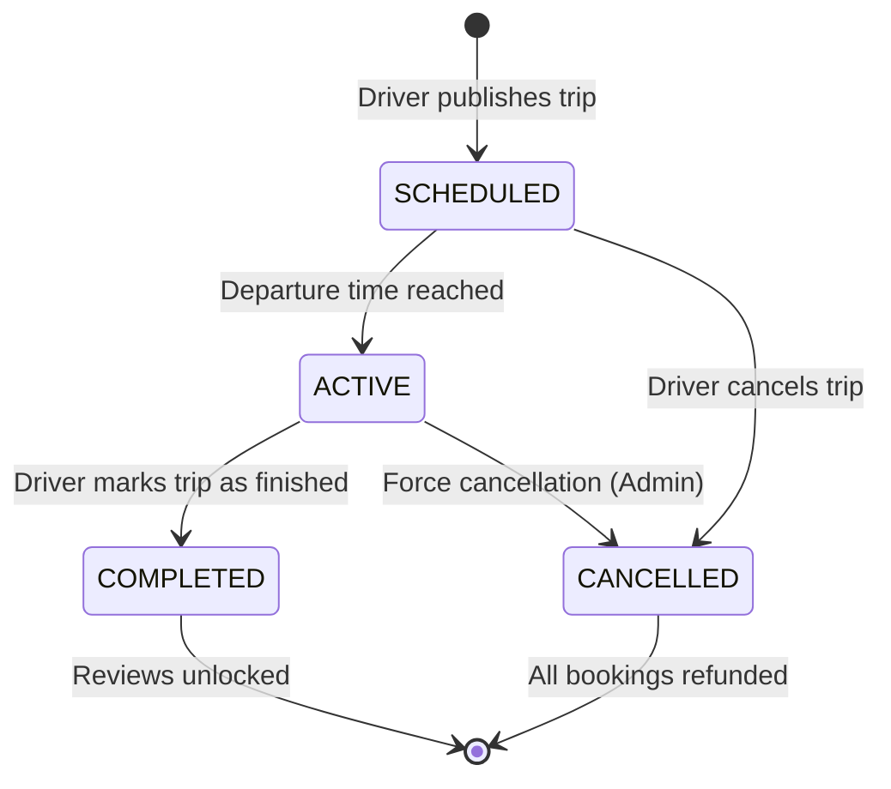
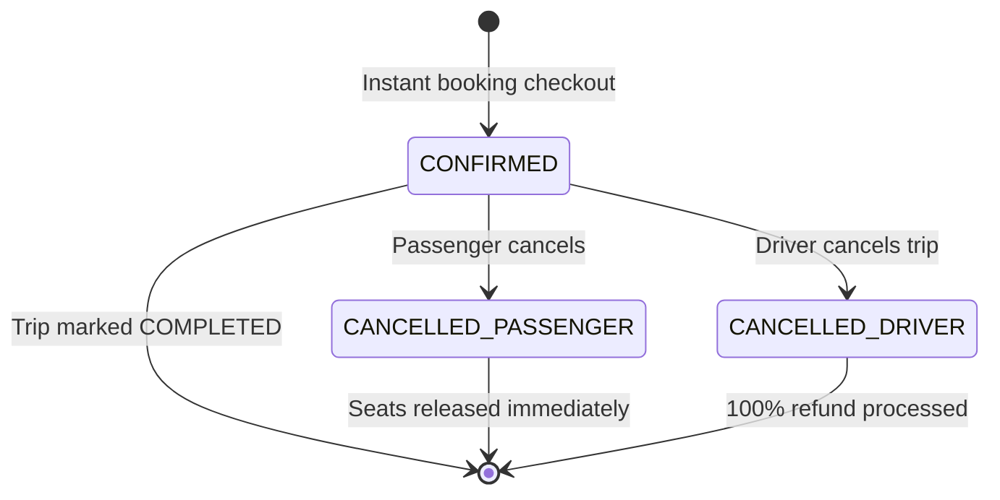

# 📐 Data Domain Model (Modèle de Données) — Subject 3: Regional Carpooling

This document provides the complete technical and architectural specification of the relational data domain model for the **SafarCar** regional carpooling platform, fulfilling all requirements of **Level 1 (Method: 10 points)**.

---

## 1. UML Class Diagram (PlantUML)

This diagram is authored using **PlantUML** (source: [`docs/diagrams/class_diagram.puml`](diagrams/class_diagram.puml)) and compiled via the official `plantuml.jar` engine:



*(A vector SVG version is also available at [`docs/images/class_diagram.svg`](images/class_diagram.svg) for lossless rendering in reports and print documents).*

---

## 2. Relational Entity Relationship Diagram (Mermaid)



---

## 2. Architectural Deep-Dive: Atomic Segment Inventory Pattern

### 2.1 The Multi-Stop Sub-Segment Problem
In Moroccan inter-city carpooling (e.g., **Agadir $\rightarrow$ Essaouira $\rightarrow$ Safi $\rightarrow$ Casablanca**), trips rarely operate point-to-point. 

A naive data model that stores available seats as a single integer on the `Trip` entity (`trip.available_seats`) fails immediately:
- If a passenger books **Agadir $\rightarrow$ Essaouira**, decrementing `trip.available_seats` would falsely block another passenger from booking **Safi $\rightarrow$ Casablanca**, even though the car will be completely empty between Safi and Casablanca.
- Conversely, storing independent bookings without segment breakdown leads to severe overbooking or under-utilization of the vehicle fleet.

### 2.2 Mathematical Formalization of the Atomic Segment Solution
Let Trip $T$ have an ordered sequence of $N$ intermediate stops:
$$\mathcal{S} = (s_0, s_1, s_2, \dots, s_{N-1})$$

The trip is automatically decomposed into $N - 1$ **consecutive atomic segments**:
$$\Sigma = (\sigma_0, \sigma_1, \dots, \sigma_{N-2})$$
where each segment $\sigma_k$ connects stop $s_k$ to stop $s_{k+1}$.

#### Example: Agadir $\rightarrow$ Essaouira $\rightarrow$ Safi $\rightarrow$ Casablanca (4 stops, 3 segments)
| Stop Index | City | Atomic Segment | Segment Order | From $\rightarrow$ To |
|:---|:---|:---|:---:|:---|
| $s_0$ | Agadir | $\sigma_0$ | 0 | Agadir $\rightarrow$ Essaouira |
| $s_1$ | Essaouira | $\sigma_1$ | 1 | Essaouira $\rightarrow$ Safi |
| $s_2$ | Safi | $\sigma_2$ | 2 | Safi $\rightarrow$ Casablanca |
| $s_3$ | Casablanca | — | — | *Final Destination* |

#### Reservation Projection Across Segments
When a passenger requests a booking $B$ from boarding stop $s_i$ to alighting stop $s_j$ with $0 \le i < j \le N-1$:
1. The booking spans the subset of contiguous segments:
   $$\Sigma(B) = \{\sigma_k \mid i \le k < j\}$$
2. **Availability Check (Precondition):**
   The booking is valid if and only if every segment in $\Sigma(B)$ has sufficient capacity:
   $$\min_{\sigma \in \Sigma(B)} (\text{availableSeats}(\sigma)) \ge \text{seatsBooked}(B)$$
3. **Capacity Decrement:**
   Upon confirmation of booking $B$:
   $$\forall \sigma \in \Sigma(B): \quad \text{availableSeats}(\sigma) \leftarrow \text{availableSeats}(\sigma) - \text{seatsBooked}(B)$$
4. **Independent Re-use of Empty Segments:**
   A passenger traveling $s_0 \rightarrow s_1$ and another traveling $s_2 \rightarrow s_3$ occupy disjoint sets of segments ($\{\sigma_0\} \cap \{\sigma_2\} = \emptyset$), enabling 100% vehicle capacity reuse without conflict!

---

## 3. Concurrency Control & Database Locking Strategy

### 3.1 Eliminating Race Conditions
When two users concurrently attempt to book the last remaining seat on overlapping segments (e.g., User A books Agadir $\rightarrow$ Casablanca while User B books Essaouira $\rightarrow$ Safi), a classic race condition occurs if read and write operations are not synchronized.

### 3.2 Pessimistic Write Lock (`SELECT ... FOR UPDATE`)
The platform enforces ACID guarantees using Doctrine's pessimistic write locking:
```php
$entityManager->wrapInTransaction(function() use ($trip, $fromStop, $toStop, $seats) {
    // 1. Fetch traversed segments ordered by segmentOrder ASC
    $segments = $tripSegmentRepository->findSegmentsForPath($trip, $fromStop, $toStop);

    // 2. Lock each segment row in MySQL (SELECT ... FOR UPDATE)
    foreach ($segments as $segment) {
        $entityManager->lock($segment, LockMode::PESSIMISTIC_WRITE);
        
        // 3. Verify real-time invariant inside lock
        if ($segment->getAvailableSeats() < $seats) {
            throw new InsufficientSeatsException("Seat no longer available on " . $segment);
        }
    }

    // 4. Safely decrement seats and persist Booking + BookingSegment
    foreach ($segments as $segment) {
        $segment->setAvailableSeats($segment->getAvailableSeats() - $seats);
    }
});
```

### 3.3 Deadlock Prevention Guarantee
To mathematically eliminate deadlocks between concurrent multi-segment transactions, **all locks are strictly acquired in ascending order of `segment_order`** (`ORDER BY segment_order ASC`). This satisfies Dijkstra’s resource hierarchy condition: no circular wait can ever form.

---

## 4. Domain Enums & State Transitions

### 4.1 Trip Status Lifecycle (`TripStatus`)


- `SCHEDULED`: Trip is visible in search results, available for booking.
- `ACTIVE`: Journey is currently in progress.
- `COMPLETED`: Journey concluded. Post-trip reviews are now unlocked.
- `CANCELLED`: Trip was cancelled by driver or administrator. All associated bookings transition to `CANCELLED_DRIVER`.

### 4.2 Booking Status Lifecycle (`BookingStatus`)


- `CONFIRMED`: Seats reserved and decremented on all spanned atomic segments.
- `CANCELLED_PASSENGER`: Passenger cancelled. Seats immediately released (`availableSeats += seatsBooked`). Refund percentage applied based on departure window (>24h: 100%, <24h: 50%).
- `CANCELLED_DRIVER`: Driver cancelled the trip. 100% refund guaranteed to passenger.

---

## 5. Unique Constraints & Database Indexes

| Table | Constraint / Index Name | Columns | Purpose |
|:---|:---|:---|:---|
| `user` | `UNIQ_IDENTIFIER_EMAIL` | `email` | Guarantees uniqueness of user logins. |
| `city` | `UNIQ_CITY_NAME` | `name` | Prevents duplicate Moroccan city records. |
| `trip_stop` | `uniq_trip_stop_order` | `trip_id, stop_order` | Guarantees sequential order of stops within a trip. |
| `review` | `uniq_review_author_target_trip` | `author_id, target_id, trip_id` | **Anti-Spam Invariant:** Guarantees a user can review a participant at most once per trip. |
| `trip` | `idx_trip_departure_status` | `departure_city_id, status, departure_at` | High-performance index for homepage trip search. |
| `trip_segment` | `idx_segment_trip_order` | `trip_id, segment_order` | High-performance index for segment path traversal and locking. |

---

## 6. Business Invariants Summary

1. **Self-Booking Prohibition:** A driver can never book a seat on their own published trip (enforced by `TripVoter` & `BookingService`).
2. **Atomic Inventory Integrity:** At all times, for any segment $\sigma$:
   $$0 \le \text{availableSeats}(\sigma) \le \text{totalSeats}(T)$$
3. **Review Eligibility:** A review can only be submitted if:
   - Trip status is `COMPLETED`.
   - The reviewer was a confirmed participant (`CONFIRMED`).
   - Reviewer has not already submitted a review for that target user on that trip.
4. **Immediate Seat Reclamation:** Whenever a booking transitions to `CANCELLED_PASSENGER`, seats are re-credited to `TripSegment.availableSeats` in the same atomic transaction.
