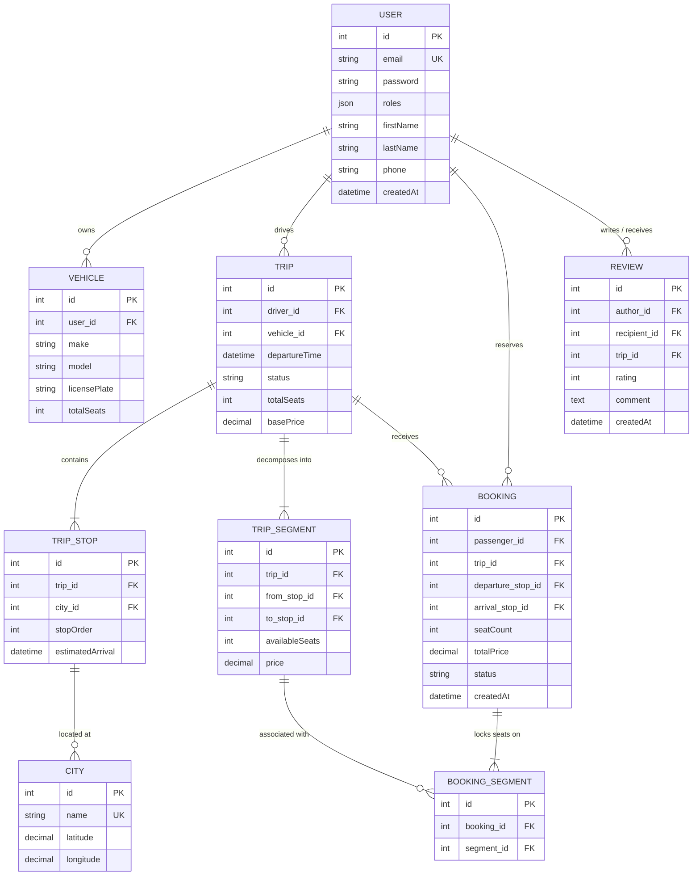

# 📐 Data Domain Model (Modèle de Données) — Subject 3: Regional Carpooling

This document details the relational data model for the regional carpooling platform, including entity relationships and the architectural strategy for managing multi-leg stopovers and partial sub-segment bookings.

---

## 1. Entity Relationship Diagram (Mermaid)

---

## 2. Architectural Design: Atomic Segments & Seat Inventory

### The Multi-Stop Sub-Segment Challenge
In Moroccan inter-city carpooling (e.g. `Agadir` $\rightarrow$ `Marrakech` $\rightarrow$ `Casablanca`), drivers rarely make non-stop trips. Passengers book either full journeys or intermediate portions.

### How the Model Solves This
1. A trip with $N$ stops is broken down into $N-1$ **atomic consecutive segments** (`TripSegment`).
   - Stop 0: Agadir $\rightarrow$ Stop 1: Marrakech (**Segment 1**)
   - Stop 1: Marrakech $\rightarrow$ Stop 2: Casablanca (**Segment 2**)
2. When a passenger books **Agadir $\rightarrow$ Marrakech**, they reserve a seat on **Segment 1** only.
3. **Segment 2** remains free and available for another passenger booking **Marrakech $\rightarrow$ Casablanca**.
4. When checking availability for a trip from Stop $i$ to Stop $j$, the system verifies that **all** intermediate segments $[i, i+1], ..., [j-1, j]$ satisfy:
   $$\min(\text{availableSeats}_{k}) \ge \text{requestedSeats}$$
5. During booking, a **pessimistic write lock** (`SELECT ... FOR UPDATE`) is acquired on these specific `TripSegment` rows within a database transaction, guaranteeing zero race conditions and zero overbooking.
